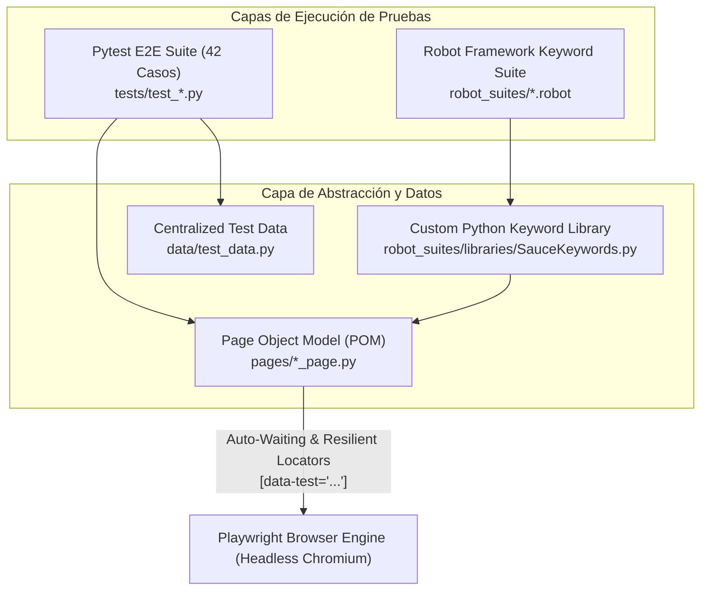

# E2E Web Test Automation Framework (Playwright + Pytest POM + Robot Framework)


Framework de automatización de pruebas **End-to-End (E2E)** de grado industrial construido con **Python 3**, **Playwright**, **Pytest** y **Robot Framework** (Keyword-Driven Testing), estructurado bajo el patrón arquitectónico **Page Object Model (POM)** e integrado en pipelines de **GitHub Actions** con captura automática de evidencias (screenshots, videos y trazas) ante fallos.

---

## 🏛️ Arquitectura del Framework



---

## 📂 Estructura del Repositorio

```text
e2e-playwright-automation/
├── .github/
│   └── workflows/
│       └── e2e-tests.yml                 # Pipeline CI/CD en GitHub Actions con artefactos HTML
├── data/
│   ├── __init__.py
│   └── test_data.py                      # Credenciales tipadas, perfiles de envío y catálogo
├── pages/                                # Capa Page Object Model (POM)
│   ├── __init__.py
│   ├── base_page.py                      # Navegación base, header, carrito y menú lateral
│   ├── login_page.py                     # Locators y acciones de inicio de sesión
│   ├── inventory_page.py                 # Catálogo de productos, filtros y extracción Decimal
│   ├── cart_page.py                      # Gestión de ítems en el carrito de compras
│   ├── checkout_info_page.py             # Formulario de datos de envío y validaciones
│   ├── checkout_overview_page.py         # Resumen financiero Subtotal + Impuesto = Total
│   └── checkout_complete_page.py         # Confirmación de orden despachada
├── tests/                                # 42 Casos de Prueba Automatizados en Pytest
│   ├── __init__.py
│   ├── conftest.py                       # Fixtures aisladas por contexto de navegador
│   ├── test_authentication.py            # Login exitoso, usuario bloqueado y particiones negativas
│   ├── test_inventory_sorting.py         # Ordenamiento numérico/alfabético y catálogo dinámico
│   ├── test_cart_and_navigation.py       # Estado del badge, agregar/remover múltiples productos
│   └── test_checkout_e2e.py              # Flujo completo de compra, BVA de formulario y precisión Decimal
├── robot_suites/                         # Suite Keyword-Driven en Robot Framework
│   ├── libraries/
│   │   └── SauceKeywords.py              # Librería personalizada en Python para Robot Framework
│   ├── authentication.robot              # Casos de prueba de autenticación en sintaxis Gherkin/Keyword
│   └── checkout_e2e.robot                # Flujo E2E de compra automatizado con Keywords
├── .gitignore
├── pytest.ini                            # Configuración de runners, marcadores y capturas de fallo
├── requirements.txt                      # Dependencias de Python, Playwright y Robot Framework
└── README.md                             # Documentación técnica
```

---

## 🧪 Cobertura de los 42 Casos de Prueba Automatizados

| Módulo | Archivo | Casos | Descripción Técnica |
|---|---|:---:|---|
| **Autenticación & Seguridad** | `tests/test_authentication.py` | 10 | Login estándar, `locked_out_user`, cierre de sesión (logout) y 7 particiones de equivalencia negativas parametrizadas. |
| **Catálogo & Ordenamiento** | `tests/test_inventory_sorting.py` | 10 | Ordenamiento por precio ascendente/descendente (`Decimal`), orden alfabético A-Z / Z-A y verificación de los 6 productos del catálogo. |
| **Carrito & Navegación Dinámica** | `tests/test_cart_and_navigation.py` | 12 | Incremento/decremento de badge para 1..6 ítems, remoción desde catálogo y carrito, persistencia en sesión y navegación continua. |
| **Checkout E2E & Validaciones** | `tests/test_checkout_e2e.py` | 10 | Compra E2E con verificación matemática `Subtotal + Tax == Total`, cancelación en pasos 1 y 2, y validación de campos obligatorios. |
| **Robot Framework Suite** | `robot_suites/*.robot` | +6 | Casos Keyword-Driven integrados con librería Python personalizada (`SauceKeywords.py`). |

---

## 🚀 Instalación y Ejecución

```bash
git clone https://github.com/jdabid/e2e-playwright-automation.git
cd e2e-playwright-automation
python3 -m venv .venv
source .venv/bin/activate
pip install -r requirements.txt
playwright install chromium
```

### Ejecutar Suite Pytest + Playwright (Headless)
```bash
pytest -v
```

### Ejecutar Suite Robot Framework
```bash
robot --outputdir reports/robot robot_suites/
```

---

## 👨‍💻 Autor

**Cristian David Castro**  
*QA Automation Engineer / SDET Junior | Estudiante de Ingeniería de Sistemas (8vo Semestre)*  
- GitHub: [@jdabid](https://github.com/jdabid)
- YouTube: [@capyzendev](https://www.youtube.com/@capyzendev)

